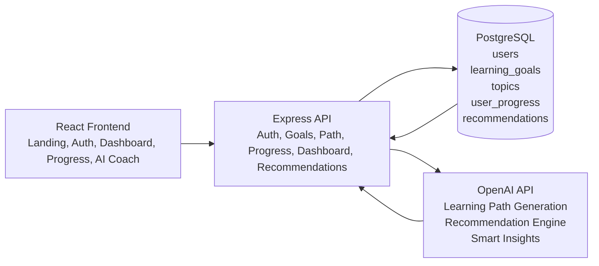
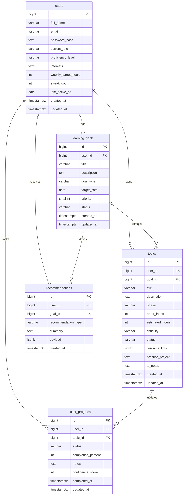
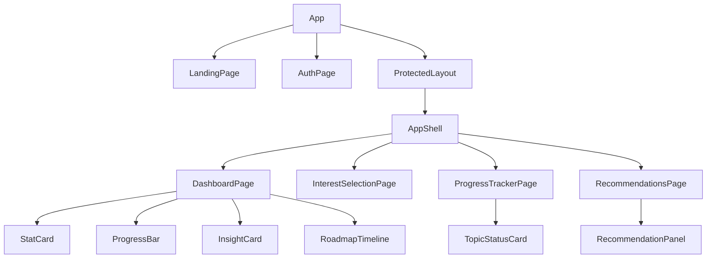

# System Design

## 1. System Architecture Diagram


### Runtime flow
1. The user signs up and stores interests, profile details, and learning goals.
2. The backend requests a structured learning path from the AI service.
3. Topics and progress records are stored in PostgreSQL.
4. As the user marks progress, the recommendation engine generates the next best learning actions.
5. The dashboard visualizes roadmap status, progress, confidence, and AI insights.

## 2. Database Schema

### Entity relationship diagram


### Table intent
- `users`: identity, profile, interests, pace, and streak metadata.
- `learning_goals`: active and historical learning goals per user.
- `topics`: the AI-generated roadmap sequence for a goal.
- `user_progress`: completion state, notes, and confidence for each topic.
- `recommendations`: persisted AI-generated recommendation snapshots.

## 3. API Routes

| Method | Route | Purpose |
|---|---|---|
| `POST` | `/api/auth/signup` | Register user and return JWT |
| `POST` | `/api/auth/login` | Authenticate user and return JWT |
| `GET` | `/api/auth/me` | Fetch current user profile |
| `GET` | `/api/profile` | Get profile and all goals |
| `PUT` | `/api/profile` | Update role, interests, level, and weekly hours |
| `GET` | `/api/goals` | List learning goals |
| `POST` | `/api/goals` | Create a new learning goal |
| `GET` | `/api/learning-path` | Fetch generated roadmap for the active goal |
| `POST` | `/api/learning-path/generate` | Generate or regenerate AI roadmap |
| `GET` | `/api/progress` | Get topic progress summary |
| `PATCH` | `/api/progress/:topicId` | Update topic status, notes, and confidence |
| `GET` | `/api/dashboard` | Fetch dashboard summary, roadmap, and latest recommendation |
| `GET` | `/api/recommendations/latest` | Get latest recommendation snapshot |
| `GET` | `/api/recommendations/insights` | Get current AI insights payload |
| `POST` | `/api/recommendations/generate` | Generate a fresh AI recommendation set |

## 4. React Component Structure


### Component responsibilities
- `AppShell`: navigation, layout, session context, and global chrome.
- `LandingPage`: product value proposition and entry CTA.
- `AuthPage`: signup and login flows.
- `InterestSelectionPage`: collect interests, goals, target timeline, and weekly pace.
- `DashboardPage`: progress summary, roadmap overview, and AI snapshot.
- `ProgressTrackerPage`: update per-topic status, notes, and confidence.
- `RecommendationsPage`: generate and inspect AI next-step suggestions.

## 5. Example AI Prompts for Recommendation Engine

### Learning path prompt
```text
Create a personalized learning path for a learner.

Learner profile:
- Name: Asha Patel
- Current role: Computer Science Student
- Proficiency: beginner
- Interests: Web Development, AI
- Weekly target hours: 8

Goal:
- Title: Become a Full Stack Developer
- Description: I want to build and deploy production-ready web applications.

Return valid JSON only with this shape:
{
  "topics": [
    {
      "title": "string",
      "description": "string",
      "phase": "string",
      "orderIndex": 1,
      "estimatedHours": 6,
      "difficulty": "beginner|intermediate|advanced",
      "practiceProject": "string",
      "resources": [{ "title": "string", "url": "https://example.com" }],
      "aiNotes": "string"
    }
  ]
}
```

### Recommendation prompt
```text
Analyze this learner and recommend the next best learning actions.

Learner profile:
- Goal: Become a Full Stack Developer
- Interests: Web Development, AI
- Weekly target hours: 8

Learning roadmap progress:
[
  { "title": "HTML Foundations", "status": "completed", "confidenceScore": 82 },
  { "title": "CSS Layouts", "status": "completed", "confidenceScore": 61 },
  { "title": "JavaScript Fundamentals", "status": "in_progress", "confidenceScore": 45 },
  { "title": "React Fundamentals", "status": "pending", "confidenceScore": 50 }
]

Return valid JSON only:
{
  "summary": "string",
  "nextTopics": [{ "title": "string", "reason": "string", "expectedOutcome": "string" }],
  "practiceProjects": [{ "title": "string", "description": "string", "focusArea": "string" }],
  "resources": [{ "title": "string", "url": "https://example.com" }],
  "revisionAreas": [{ "title": "string", "reason": "string" }],
  "weakAreas": ["string"],
  "encouragement": "string"
}
```

## 6. UI Wireframes

### Landing Page
```text
+--------------------------------------------------------------------------------+
| Logo                 Personalized Learning Recommendation System      Sign Up  |
+--------------------------------------------------------------------------------+
| Learn with an adaptive roadmap that evolves with your progress.               |
| [Start your roadmap] [Explore features]                                       |
|                                                                                |
|  AI Coach Card                Roadmap Chips                Streak / Stats      |
+--------------------------------------------------------------------------------+
| Feature Card            | Feature Card            | Feature Card               |
+--------------------------------------------------------------------------------+
```

### Login / Signup
```text
+-------------------------------------------------------------+
| [Sign up] [Login]                                           |
| Create your AI learning workspace                           |
| Name        Email                                           |
| Password    Current Role                                    |
| Skill Level                                                |
| [Create account]                                            |
+-------------------------------------------------------------+
```

### Interest Selection Page
```text
+--------------------------------------------------------------------------------+
| Tell the system what you want to learn                                         |
| Full name        Current role                                                  |
| Skill level      Weekly target hours                                           |
| Learning goal                                                                 |
| Goal description                                                              |
| Interests: [Web Development] [AI] [Data Science] [Backend] [Frontend]         |
| [Save profile and generate roadmap]                                           |
+--------------------------------------------------------------------------------+
```

### Learning Dashboard
```text
+--------------------------------------------------------------------------------+
| Goal: Become a Full Stack Developer                                            |
| Progress Bar: 55%                                                              |
+--------------------------------------------------------------------------------+
| Completed | In Progress | Confidence | Streak                                  |
+--------------------------------------------------------------------------------+
| Smart Insight Card          | Roadmap Health Card                              |
+--------------------------------------------------------------------------------+
| Roadmap Timeline: HTML -> CSS -> JavaScript -> React -> Node -> Deployment    |
+--------------------------------------------------------------------------------+
```

### Topic Progress Tracker
```text
+--------------------------------------------------------------------------------+
| Progress tracker for current goal                                              |
| Progress Bar                                                                   |
+--------------------------------------------------------------------------------+
| Topic Card                 | Topic Card                                        |
| Status dropdown            | Confidence slider                                |
| Notes textarea             | Save progress                                     |
+--------------------------------------------------------------------------------+
```

### AI Recommendation Page
```text
+--------------------------------------------------------------------------------+
| AI recommendation engine                                 [Generate insights]   |
+--------------------------------------------------------------------------------+
| AI Summary Card                                                                |
+--------------------------------------------------------------------------------+
| Learn next            | Practice projects                                      |
| Resources             | Revision areas                                         |
+--------------------------------------------------------------------------------+
```

## Scalability Notes
- AI logic is isolated in `server/src/services/aiService.js`, which makes it easy to swap OpenAI for Gemini.
- Controllers use clear route boundaries that can be split into domain modules or microservices later.
- Recommendation snapshots are stored as JSONB so the insight payload can evolve without immediate schema churn.
- The frontend is page-based with reusable dashboard components, which keeps future features like quizzes or weekly reports straightforward to add.
